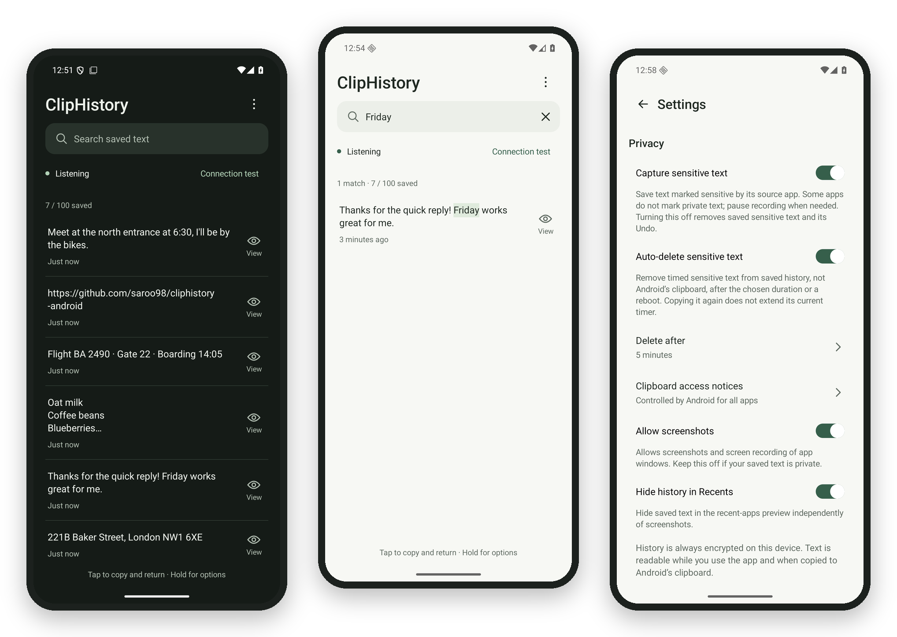
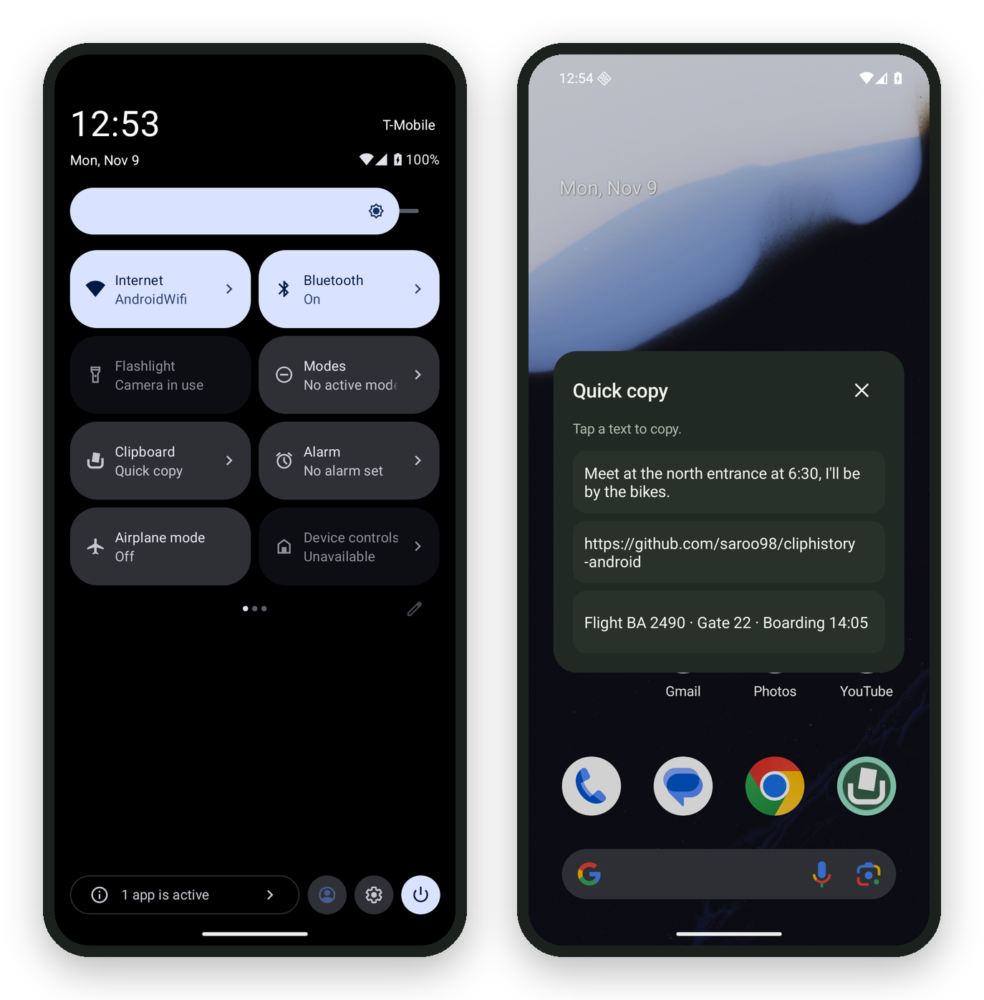

<div align="center">

<picture>
  <source media="(prefers-color-scheme: dark)" srcset="branding/cliphistory-dark.svg">
  
</picture>

### Everything you copy, saved and ready to copy again.

A clean, private clipboard history for Android.<br>
Works with any keyboard. Encrypted on your phone. 100% offline.

[](https://github.com/saroo98/cliphistory-android/releases/latest)
[](#get-started)
[](#private-by-design)
[](LICENSE)

[**Download**](https://github.com/saroo98/cliphistory-android/releases/latest) &nbsp;·&nbsp; [Get started](#get-started) &nbsp;·&nbsp; [Suggest a feature](https://github.com/saroo98/cliphistory-android/issues/new)

<br>



</div>

<br>

## Why ClipHistory

Android remembers only the last thing you copied. ClipHistory quietly keeps the rest, so that address, link or message from an hour ago is always one tap away.

- **Works with the keyboard you already use.** ClipHistory is an app, not a keyboard. Keep Gboard, SwiftKey or anything else.
- **One tap from anywhere.** Your latest copies are a swipe and a tap away, right from Quick Settings.
- **Private by default.** No internet, no account, no ads, no tracking. Your history never leaves your phone.
- **Calm, modern design.** A clean interface in light or dark that feels at home on Android and stays out of your way.
- **Yours to shape.** Nearly everything can be adjusted, from how much is saved to how the app looks and behaves.
- **Free and open source.** MIT licensed. Every line can be read and checked.

## Features

### One tap from anywhere: the Quick Settings tile

Add the **Clipboard** tile to your phone's Quick Settings (the panel you open by swiping down from the top of the screen). Tap it from any app and a small **Quick copy** panel appears with your three latest copies. Tap one to copy it, and the panel closes so you can paste right away. Prefer the full history? The tile can open that instead.

<div align="center">

</div>

### Copy again in one tap
- **Tap to copy and return.** Tap any entry in the app to copy it and jump straight back to what you were doing.
- **Search everything.** Find any saved text instantly, with matches highlighted, even inside long entries.
- **Full text view.** Open any entry to read and select the exact text, with spacing, line breaks and emoji intact.
- **Undo.** Deleted something by mistake? Bring it back with one tap.

### Private by design
- **Encrypted on your phone.** All saved history is protected with AES-256-GCM, with the key kept in Android's secure Keystore.
- **100% offline.** The app has no internet permission at all, so nothing can be sent anywhere.
- **Passwords handled with care.** Text that apps mark as private, such as passwords, is skipped by default. Prefer to keep it? Turn it on and it deletes itself after 5 minutes, or a time you choose.
- **Screenshots blocked.** Screenshots and screen recording of the app are blocked by default, and your history can be hidden from the recent apps screen.
- **Hidden until you look.** Saved private entries stay covered in the list and the quick panel until you choose to view them.

### Make it yours
- **History size** from 20 to 500 entries.
- **Duplicates:** keep one entry per text, or skip only repeats in a row.
- **Appearance:** light, dark or follow the system, with motion that can follow the system or be turned off.
- **Copy behavior:** return to your app after copying, or stay in ClipHistory.
- **Quick Settings tile:** open the Quick copy panel or the full history.
- **Pause anytime**, and choose whether recording resumes by itself after interruptions and restarts.

### Light and dependable
- Saves copies the moment they happen, without constantly checking the clipboard in the background.
- No accessibility service, no screen overlay permission and no replacement keyboard.
- Clear, step-by-step setup and built-in help, with a one-tap connection test.

## Get started

ClipHistory runs on **Android 11 or newer** and uses [Shizuku](https://shizuku.rikka.app/), a free and widely used app that lets apps like this one work in the background without root.

1. **Install ClipHistory** from the [latest release](https://github.com/saroo98/cliphistory-android/releases/latest).
2. **Install and start Shizuku** using wireless debugging. ClipHistory's built-in guide walks you through it.
3. **Open ClipHistory, tap Connect** and allow access. Then copy anything, anywhere. It is saved.

Add the **Clipboard** tile to Quick Settings for one-tap access: ClipHistory offers it in Settings, or add it yourself from Quick Settings → Edit. After restarting your phone, start Shizuku again and ClipHistory picks up where it left off.

<details>
<summary><b>Rooted phone?</b> Set it up once and never think about it again.</summary>
<br>

Use [Sui with Shell mode](https://github.com/XiaoTong6666/Sui), which starts by itself with your phone:

1. Install the Sui module in Magisk with Zygisk enabled (or in KernelSU or APatch with a Zygisk implementation), then reboot.
2. Open ClipHistory and tap **Connect**. When Sui asks, choose **Always (Shell)**.

Recording now resumes by itself after every restart, with no wireless debugging needed. If you picked another option by mistake, open Sui (long-press the Settings app icon, then tap Sui), choose **Allowed (Shell)** for ClipHistory and return to the app.

</details>

## Have an idea?

ClipHistory is actively developed, and your feedback shapes what comes next. If there is a feature you wish it had, something that could work better, or anything that feels missing, [open an issue](https://github.com/saroo98/cliphistory-android/issues/new) and tell me about it. I read every request and will do my best to build it, to the same high standard as the rest of the app.

Found a bug? Reports are just as welcome. A short description and your phone model help a lot.

If ClipHistory makes your day a little easier, a star on GitHub helps others find it.

## For developers

<details>
<summary><b>How it works</b></summary>
<br>

```text
Any app → Android clipboard → ClipHistory recorder (via Shizuku)
                                        ↓
                         encrypted history on your phone
                                        ↓
                        ClipHistory app and Quick Settings tile
```

A small recorder runs through Shizuku and listens for clipboard changes as they happen. It writes every snapshot with AES-256-GCM into the app's private storage, using two alternating copies so history survives interruptions. The data key is wrapped by an app-owned Android Keystore key. The app talks to the recorder over a bounded, owner-checked AIDL interface, and can still read and copy saved history while the recorder is stopped.

See [SECURITY.md](SECURITY.md) for the full security model.

</details>

<details>
<summary><b>Build and test</b></summary>
<br>

On Windows, double-click **`BUILD_WINDOWS.cmd`**. See [START_HERE.md](START_HERE.md) for a short walkthrough and [BUILDING.md](BUILDING.md) for details.

With an Android SDK installed:

```sh
./gradlew :app:testDebugUnitTest :app:lintRelease :app:assembleRelease
```

Fast host tests (Kotlin CLI and Java 17+):

```sh
bash tools/test-core.sh
python3 tools/audit_source.py
```

Release signing uses owner-local keys. Without them, the release APK is unsigned. Device test procedures are in [DEVICE_TESTS.md](DEVICE_TESTS.md).

</details>

<details>
<summary><b>Project layout</b></summary>
<br>

| Folder | What it holds |
| --- | --- |
| `core/` | History rules, storage format and encryption, with host tests |
| `daemon/` | The Shizuku recorder and its storage writer |
| `client/` | Shizuku connection and app-side history access |
| `ui/` | The app screens and the Quick Settings tile |
| `app/src/main/aidl/` | The interface between app and recorder |
| `tools/` | Tests, source audit and build scripts |
| `fdroid/`, `fastlane/` | F-Droid recipe and store listing |

All under `app/src/main/java/app/cliphistory/` unless noted.

</details>

## License

ClipHistory is released under the [MIT License](LICENSE). Shizuku, Kotlin and Android libraries keep their own licenses; see [THIRD_PARTY_NOTICES.md](THIRD_PARTY_NOTICES.md).
